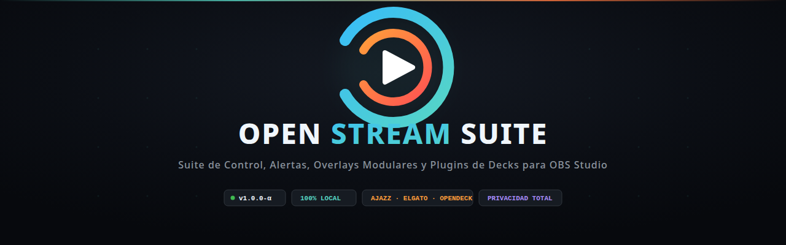

<p align="center">
  
</p>

<p align="center">
  <a href="README.md">Español</a> | <b>English</b>
</p>

# OPEN STREAM SUITE — MODULAR OVERLAYS, ALERTS & CONTROL SUITE FOR TWITCH & OBS STUDIO

> **PLAY · CREATE · SHARE**  
> Contemporary, modular, and lightweight visual identity for gaming, programming, maker streams, content creation, and just chatting.  
> 🚀 **[Step-by-Step Installation & Startup Guide](INSTALLATION_AND_STARTUP.md)** · [Español](INSTALACION_E_INICIO.md)

---

## 1. Overview

**Open Stream Suite** is a collection of professional, modular overlays and streaming tools tailored for content creators. Instead of loud, heavy, generic gaming templates, it uses a technical, clean aesthetic: registration marks, clean monospace typography for metadata, subtle accent colors, and deep respect for on-screen live content.

### Key Features
- **100% Offline (No Internet connection required for overlays)**: Typography is bundled locally in `common/fonts/` and served by the backend. Works completely offline on your computer without external CDNs.
- **Ultra-lightweight Performance**: Built with native HTML5, CSS3, and Vanilla JavaScript. Zero heavy web frameworks or npm build steps for the frontend.
- **True Transparency**: Live broadcast scenes have real transparent backgrounds so games, terminals, and webcams sit seamlessly underneath without muddy dark tint filters.
- **Centralized Configuration**: Edit streamer channel names, project titles, active development phases, and social links from [`app/config.js`](app/config.js) or via the web control panel.
- **Modular Themes & Factory Reset**: Complete theme packs in `themes/<pack>/<theme>/` with backup `.default.json` / `.default.css` files allowing 1-click instant factory restoration.
- **Independent Visual Themes per Scene**: Each OBS Studio scene overlay can wear its own style (Arcade for Gaming, Chill for Just Chatting, Cyberpunk for coding/tech, etc.).
- **Physical Deck Plugins**: Native integrations in [`plugins/`](plugins/README.en.md) for Elgato Stream Deck, Ajazz AKP05 (10 keys + panoramic touch strip + 4 knobs), Ajazz AKP153/03/846, and OpenDeck (Bitfocus Companion).
- **Robust Security**: Whitelisted file upload controls, anti path-traversal protection, CORS restricted to localhost/custom domain, and cryptographic local token authentication for mutating requests.

---

## 2. Project Structure

```text
OpenStreamSuite/
├── README.md               # Spanish README
├── README.en.md            # English README (this file)
├── INSTALLATION_AND_STARTUP.md # Step-by-step installation and startup guide
├── LICENSE                 # License (PolyForm Noncommercial 1.0.0)
├── CONTRIBUTING.en.md      # How to contribute
├── CHANGELOG.en.md         # Version history
│
├── Iniciar Open Stream Suite.sh / .bat / .command   # 1-click root launchers
├── installers/             # Automated installers (Linux, Windows, macOS)
│   ├── install_linux.sh
│   ├── install_windows.bat
│   └── install_macos.command
│
├── languages/              # Multi-language dictionary files (JSON)
│   ├── es.json             # Spanish localization
│   └── en.json             # English localization
│
├── imagencorp/             # Visual identity, vector logos, and screenshots
│   ├── README.en.md        # Brand manual and color palette
│   ├── logos/              # Symbols, favicon, horizontal logos (SVG & PNG)
│   └── screenshots/        # High-resolution live screenshots
│
├── plugins/                # Physical deck plugins and macros
│   ├── README.en.md        # Deck plugins setup guide
│   ├── stream_deck/        # Native Elgato Stream Deck plugin (.sdPlugin)
│   ├── ajazz/              # Ajazz AKP05 & AKP153 profiles + CLI bridge
│   ├── opendeck_companion/ # Companion page for OpenDeck and stream controllers
│   └── assets/             # SVG icons for LCD buttons
│
└── app/                    # Core project files
    ├── CONVENTIONS.en.md   # Architecture standards & dev guidelines
    ├── config.js           # Stream customization settings
    ├── index.html          # Interactive scene catalog & preview
    ├── server.py           # Backend Python server (aiohttp + WebSockets)
    ├── launcher.py         # Desktop launcher application
    ├── requirements.txt    # Python dependencies
    ├── .env.example        # Environment variables template
    ├── server/             # Modular backend (routes, state, EventSub, IRC)
    ├── alerts/             # Web control panel & OBS alert engine
    ├── widgets/            # Chat, goals, shoutout, ticker, and timer
    ├── overlays/           # OBS Studio broadcast scenes
    ├── themes/             # Modular theme packs
    ├── common/             # Shared CSS, local fonts, and i18n engine
    └── tests/              # Automated unit tests (49 tests)
```

---

## 3. Step-by-Step OBS Studio Setup

All overlays are local HTML files loaded into OBS as **Browser Sources**.

### Step 1: Base Canvas Setup
1. Open **OBS Studio**.
2. Go to **Settings** → **Video**.
3. Set both **Base (Canvas) Resolution** and **Output (Scaled) Resolution** to **`1920x1080`**.

### Step 2: Create Your Broadcast Scenes
In the *Scenes* dock, create a scene for each stream mode:
- `1 - GAME`
- `2 - MAIN SCENE` *(camera + desk/webcam)*
- `3 - PC SCREEN` *(screen share + webcam)*
- `4 - SECONDARY CAM` *(workbench, 3D printer, or action)*
- `5 - DESIGN SCREEN` *(full-screen app)*
- `6 - CHILL` *(Just Chatting)*
- `7 - STARTING SOON`
- `8 - BRB / PAUSE`
- `9 - ENDING`

### Step 3: Add an Overlay to a Scene
1. Select the scene in OBS (e.g. `2 - MAIN SCENE`).
2. In the **Sources** dock, click **`+`** and choose **Browser**.
3. Name it `Overlay - Main Scene`.
4. In the source properties:
   - Check **Local file** and browse to `app/overlays/maker/desk/index.html` (or enter `http://localhost:8080/overlays/maker/desk/index.html`).
   - **Width**: `1920`
   - **Height**: `1080`
   - Check **Shutdown source when not visible**.
   - Check **Refresh browser when scene becomes active**.
5. Click **OK**.

### Step 4: Arrange Cameras & Capture Devices
Add video capture devices or window captures **below the overlay source**:
- **Layer Order**:
  1. `Overlay` *(always top so borders render cleanly over video)*.
  2. `Webcams / Facecam` *(secondary frames)*.
  3. `Main Capture` *(gameplay, monitor, workbench)*.

To align cameras with pixel precision, see the layout guide in [app/docs/OBS_SETUP.en.md](app/docs/OBS_SETUP.en.md).

---

## 4. Local Server & Desktop Application

Open Stream Suite includes a desktop application with a control dashboard, system tray support, server health monitor, and Twitch API credentials manager:

### Quick Install:
Run the installer for your operating system:
- **Linux**: `./installers/install_linux.sh`
- **Windows**: Double-click `installers\install_windows.bat`
- **macOS**: Double-click `installers/install_macos.command`

The installer prepares the Python virtual environment in `app/venv/`, installs dependencies, and creates system desktop shortcuts.

### Launching the Application:
Double-click the corresponding root launcher:
- 🐧 **Linux**: `Iniciar Open Stream Suite.sh`
- 🪟 **Windows**: `Iniciar Open Stream Suite.bat`
- 🍎 **macOS**: `Iniciar Open Stream Suite.command`

From the desktop launcher you can **start/stop the server**, configure Twitch credentials, switch language (ES/EN), check for software updates, and open the **Web Control Panel**.

> [!NOTE]
> **Network Security:** By default the server binds exclusively to `127.0.0.1`. To access the control panel or deck API from a secondary device or tablet on your local network, set `SERVER_HOST=0.0.0.0` and configure `DECK_TOKEN` in `app/.env` (see [`plugins/README.en.md`](plugins/README.en.md)).

### Live URLs:
- **🎛️ Streamer Control Panel**: [http://localhost:8080/alerts/panel.html](http://localhost:8080/alerts/panel.html)
- **🚨 OBS Alert Engine**: [http://localhost:8080/alerts/index.html](http://localhost:8080/alerts/index.html) *(1920×1080)*
- **📰 Interactive Catalog**: [http://localhost:8080/index.html](http://localhost:8080/index.html)

---

## 5. Modular OBS Widgets

Each widget can be loaded as an independent Browser Source in any scene:

| Widget | Local URL | Recommended Size | Description |
| :--- | :--- | :--- | :--- |
| **🚨 Alerts & Triggers** | `http://localhost:8080/alerts/index.html` | `1920 × 1080` | Animated CSS alerts & green-screen reaction clips. |
| **💬 Chat & Physics** | `http://localhost:8080/widgets/chat/index.html` | `440 × 850` | Direct Twitch IRC connection + floating bouncing emotes. |
| **⏱️ Timer** | `http://localhost:8080/widgets/timer/index.html` | `400 × 140` | Stopwatch, countdown timer, and pomodoro breaks. |
| **📢 Shoutout Card** | `http://localhost:8080/widgets/shoutout/index.html` | `600 × 200` | Holographic promo card with streamer avatar and game. |
| **🎯 Goal Bar** | `http://localhost:8080/widgets/goal/index.html` | `460 × 120` | Real-time follower, subscriber, or bits target tracker. |
| **📰 Event Ticker** | `http://localhost:8080/widgets/ticker/index.html` | `800 × 60` | Minimal broadcast ribbon for latest follow, sub, and tip. |

---

## 6. Documentation & Testing

- **Deck Plugins Setup Guide**: [plugins/README.en.md](plugins/README.en.md)
- **Deck Hardware Integration (API & Profiles)**: [app/docs/GUIA_INTEGRACION_DECKS.en.md](app/docs/GUIA_INTEGRACION_DECKS.en.md)
- **Create Themes & Scenes from Scratch**: [app/docs/GUIA_CREAR_TEMAS_Y_ESCENAS_DESDE_CERO.en.md](app/docs/GUIA_CREAR_TEMAS_Y_ESCENAS_DESDE_CERO.en.md)
- **Architecture & Conventions**: [app/CONVENTIONS.en.md](app/CONVENTIONS.en.md)
- **Development & Theme Engine Guide**: [app/docs/GUIA_DESARROLLO_Y_TEMAS.en.md](app/docs/GUIA_DESARROLLO_Y_TEMAS.en.md)
- **OBS Scene Coordinates & Measurements**: [app/docs/OBS_SETUP.en.md](app/docs/OBS_SETUP.en.md)
- **Run the Automated Test Suite** (with server running, from `app/`):
  ```bash
  ./venv/bin/python3 -m unittest discover tests -v
  ```

---

## 7. License & Contributions

Open Stream Suite is released under the **[PolyForm Noncommercial 1.0.0 License](LICENSE)**: you are free to use, modify, study, and share it for **non-commercial personal streaming purposes**. **Selling it or using it for commercial monetization is strictly prohibited** without prior written permission from the author.

> [!NOTE]
> This is a source-available license, not an OSI-approved open source license, because it restricts commercial use. Contributions and improvements are warmly welcome: see [CONTRIBUTING.en.md](CONTRIBUTING.en.md).

Third-party dependencies and assets retain their respective licenses.

Enjoy building, streaming, and sharing live! 🎮🚀
