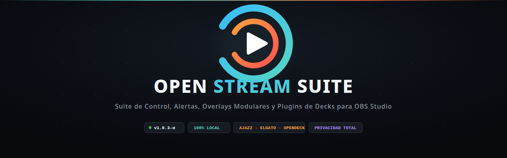

<p align="center">
  
</p>

<p align="center">
  <a href="README.md">English</a> | <b>Español</b>
</p>

# OPEN STREAM SUITE — SISTEMA COMPLETO DE OVERLAYS PARA TWITCH Y OBS STUDIO

> **JUGAR · CREAR · COMPARTIR**  
> Identidad visual contemporánea, modular y ligera para streaming de videojuegos, programación, creación de contenido, just chatting y cualquier tipo de directo.  
> 🚀 **[Guía Paso a Paso de Instalación e Inicio](app/docs/INSTALACION_E_INICIO.md)** · [English](app/docs/INSTALLATION_AND_STARTUP.md)

---

## 1. Introducción

**Open Stream Suite** es un paquete de overlays profesionales diseñado para cualquier tipo de streamer. En lugar de plantillas genéricas o recargadas con estética gamer estridente, este sistema se basa en una estética limpia y técnica: marcas de registro, tipografía monoespaciada para metadatos, toques sutiles de color de acento y un respeto absoluto por el contenido del directo.

### Características Clave
- **100% Offline (Sin conexión a Internet obligatoria para overlays)**: Las tipografías están descargadas en local en `common/fonts/` y servidas por el backend. Funciona de manera local en tu ordenador sin CDNs externas.
- **Rendimiento ultra-ligero**: Desarrollado en HTML5 nativo, CSS y Vanilla JS. Sin frameworks pesados ni dependencias npm para el frontend.
- **Transparencia real**: Las escenas de directo tienen fondo transparente real para que tus juegos, terminales y cámaras se vean debajo sin filtros oscuros molestos.
- **Configuración centralizada**: Modifica el nombre del canal, los títulos de los proyectos, las fases activas y las redes sociales desde [`app/config.js`](app/config.js).
- **Temas Modulares y Restauración de Fábrica**: Paletas y trajes visuales en `themes/<pack>/<tema>/` con respaldo `.default.json` / `.default.css` para restaurar con 1 solo clic si modificas algo por error.
- **Estilos Visuales Independientes por Overlay**: Cada overlay de OBS Studio puede vestir su propio estilo visual (Arcade para Gameplay, Chill para charla, Cyberpunk para tech, etc.).
- **Overlays con Lógica Programada y Controles Flotantes**: Las overlays son aplicaciones web dinámicas con cronómetros de centésimas, splits interactivos de speedrun (+/-), temporizadores Pomodoro sincronizados, conmutadores multicámara, insignias interactivas al clic y menús HUD flotantes reposicionables (*draggables*) sin obstruir contenido.
- **Plugins para Macro Decks**: Integraciones nativas en [`plugins/`](plugins/README.md) ([English](plugins/README.en.md)) para Elgato Stream Deck, Ajazz AKP05/AKP153 y OpenDeck (Bitfocus Companion), con guía de instalación.
- **Seguridad Robusta**: Control de subida de archivos con lista blanca y protección anti path-traversal, CORS restringido a localhost/dominio propio y autenticación con token local criptográfico en llamadas POST.

---

## 2. Estructura del Proyecto

```text
OpenStreamSuite/
├── README.md               # README principal en inglés
├── README.es.md            # README en español (este documento)
├── LICENSE                 # Licencia (PolyForm Noncommercial 1.0.0)
│
├── Linux/                  # Instaladores, lanzador, actualizador e instrucciones (ES/EN)
├── Mac/                    # Idem para macOS
├── Windows/                # Idem para Windows
│
├── app/assets/imagencorp/  # Identidad visual, logos vectoriales y capturas
│   ├── README.md           # Manual de identidad y paleta de colores
│   ├── logos/              # Isotipos, favicon y logos horizontales (SVG y PNG)
│   └── screenshots/        # Capturas de pantalla reales en alta resolución
│
├── plugins/                # Plugins para decks (fuera de app/ para encontrarlos fácil)
│   ├── README.md           # Guía de instalación de todos los plugins
│   ├── stream_deck/        # Plugin nativo Elgato (.sdPlugin)
│   ├── ajazz/              # Perfiles Ajazz AKP05 y AKP153/03/846 + bridge CLI
│   ├── opendeck_companion/ # Página lista para Bitfocus Companion y OpenDeck
│   └── assets/             # Iconos SVG para las teclas LCD
│
└── app/                    # Todo el proyecto
    ├── CONVENTIONS.md      # Estándares de arquitectura y guía para desarrollo
    ├── config.js           # Archivo central de personalización del stream
    ├── index.html          # Catálogo interactivo de previsualización local
    ├── server.py           # Servidor backend Python (aiohttp + WebSockets)
    ├── launcher.py         # Lanzador de escritorio
    ├── requirements.txt    # Dependencias Python
    ├── .env.example        # Plantilla de configuración (copiar a .env)
    ├── scripts/            # Scripts auxiliares de túneles VPS y utilidades de desarrollo
    ├── server/             # Backend modular (rutas, estado, EventSub, IRC)
    ├── alerts/             # Panel de control web y fuente de alertas para OBS
    ├── widgets/            # Chat, metas, shoutout, ticker y temporizador
    ├── overlays/           # Paquetes de escenas para OBS Studio
    ├── themes/             # Packs de temas modulares (theme.json, style.css, copias de fábrica)
    │   ├── pack_open_stream_suite/   # maker, print, terminal, chill, cyberpunk, synthwave
    │   ├── pack_personalizado/       # variante personalizable de los 6 estilos base
    │   ├── pack_retro_arcade/        # arcade_8bit, vapor_sunset
    │   ├── pack_cozy_lofi/           # cozy_terracotta, nordic_forest
    │   ├── pack_manga_ink/           # manga_dark_ink, manga_shonen
    │   └── pack_sci_fi_blueprint/    # blueprint_cad, neon_matrix
    ├── common/             # Estilos compartidos, fuentes locales y utilidades
    ├── docs/               # Guías (OBS, temas, decks, dominio propio)
    ├── scripts/            # Auxiliares (Cloudflare Tunnel, VPS)
    └── tests/              # Suite de pruebas automatizadas (47 tests)
```

---

## 3. Guía Paso a Paso para Configurar OBS Studio

Las overlays son páginas HTML locales que se añaden a OBS como **Fuentes de Navegador** (*Browser Sources*).

### Paso 1: Configurar el lienzo base
1. Abre **OBS Studio**.
2. Ve a **Ajustes** → **Vídeo**.
3. Asegúrate de que la **Resolución de la base (Lienzo)** y la **Resolución de salida** estén en **`1920x1080`**.

### Paso 2: Crear tus escenas
Crea una escena en el panel *Escenas* para cada uno de tus modos habituales de directo:
- `1 - GAME`
- `2 - ESCENA PRINCIPAL` *(cámara + webcam)*
- `3 - PANTALLA PC` *(captura de pantalla + webcam)*
- `4 - CÁMARA SECUNDARIA` *(proceso o acción en curso)*
- `5 - PANTALLA DISEÑO` *(app a pantalla completa)*
- `6 - CHILL`
- `7 - STARTING SOON`
- `8 - PAUSA`
- `9 - ENDING`

### Paso 3: Añadir la overlay a una escena
1. Selecciona la escena en OBS (por ejemplo `2 - ESCENA PRINCIPAL`).
2. En la lista de **Fuentes**, pulsa en el botón **`+`** y selecciona **Navegador** (*Browser*).
3. Nómbrala `Overlay - Escena Principal`.
4. En las propiedades de la fuente:
   - Marca la casilla **Archivo local** (*Local file*).
   - Pulsa **Examinar** y busca el archivo `app/overlays/maker/desk/index.html` (o usa la URL `http://localhost:8080/overlays/maker/desk/index.html`).
   - **Ancho**: `1920`
   - **Alto**: `1080`
   - Marca **Apagar la fuente cuando no sea visible**.
   - Marca **Actualizar el navegador cuando la escena se active**.
5. Pulsa **Aceptar**.

### Paso 4: Colocar las cámaras y capturas de vídeo
Añade tus dispositivos de captura de vídeo o capturas de pantalla **debajo de la fuente del overlay**:
- **Orden de capas**:
  1. `Overlay` *(siempre arriba para que los marcos dibujen sobre el vídeo)*.
  2. `Cámaras secundarias` *(rostro, auxiliar)*.
  3. `Cámara o captura principal` *(mesa, monitor, juego)*.

Para alinear tus cámaras exactamente con los marcos, consulta las medidas de [app/docs/OBS_SETUP.md](app/docs/OBS_SETUP.md) ([English](app/docs/OBS_SETUP.en.md)).

---

## 4. Servidor Local y App de Escritorio

El proyecto incluye una aplicación de escritorio con panel de control, bandeja del sistema (*tray*), supervisión del servidor y gestión de credenciales de Twitch:

> [!IMPORTANT]
> **Desarrollo en GNU/Linux & Feedback de la Comunidad para Windows / macOS:**  
> Desarrollamos y testeamos Open Stream Suite activamente en **GNU/Linux**. Aunque se proporcionan instaladores automáticos y lanzadores para **Windows** (`.bat`) y **macOS** (`.command`), el equipo de desarrollo **no utiliza sistemas operativos privativos en su día a día**. Por ello, el soporte y la resolución de casos especiales en Windows y Mac dependen de vuestro feedback y contribuciones. Si detectas cualquier fallo o deseas optimizar los scripts en esas plataformas, te animamos a [abrir una issue o enviar una pull request](https://github.com/AndorinaAI/open-stream-suite/issues). ¡Agradecemos enormemente vuestra colaboración!

### Instalación Rápida:
Ejecuta el instalador automático según tu sistema operativo:
- **Linux**: `./Linux/install.sh`
- **Windows**: Haz doble clic en `Windows\install.bat`
- **macOS**: Haz doble clic en `Mac/install.command`

El instalador creará el entorno virtual en `app/venv/`, instalará las dependencias y registrará el acceso directo en el sistema.

### Cómo Iniciar la Aplicación:
Haz doble clic en el script correspondiente en la raíz del proyecto:
- 🐧 **Linux**: `Linux/Iniciar Open Stream Suite.sh`
- 🪟 **Windows**: `Windows/Iniciar Open Stream Suite.bat`
- 🍎 **macOS**: `Mac/Iniciar Open Stream Suite.command`

Desde la ventana del lanzador podrás **iniciar/detener el servidor**, configurar tus credenciales de Twitch con un clic, ver cuántos clientes OBS están conectados y abrir el **Panel de Control** directamente en tu navegador.

> [!NOTE]
> **Seguridad:** Por defecto el servidor escucha exclusivamente en tu propio equipo (`127.0.0.1`). Para usar un deck o tableta desde otro dispositivo en tu red local, define `SERVER_HOST=0.0.0.0` y `DECK_TOKEN` en `app/.env` (ver [`plugins/README.md`](plugins/README.md) / [English](plugins/README.en.md)).

### URLs del Sistema en Vivo:
- **🎛️ Panel de Control del Streamer**: [http://localhost:8080/alerts/panel.html](http://localhost:8080/alerts/panel.html)
- **🚨 Fuente de Alertas y Memes para OBS**: [http://localhost:8080/alerts/index.html](http://localhost:8080/alerts/index.html) *(1920×1080)*
- **📰 Visualizador de Catálogo**: [http://localhost:8080/index.html](http://localhost:8080/index.html)

---

## 5. Widgets Modulares para OBS

Puedes añadir estos widgets independientes como fuentes de Navegador en cualquier escena:

| Widget | URL Local | Tamaño Recomendado | Descripción |
| :--- | :--- | :--- | :--- |
| **🚨 Alertas & Triggers** | `http://localhost:8080/alerts/index.html` | `1920 × 1080` | Alertas animadas + Memes/vídeos en pantalla. |
| **💬 Chat & Partículas** | `http://localhost:8080/widgets/chat/index.html` | `440 × 850` | Conexión directa a Twitch IRC + física de emotes. |
| **⏱️ Temporizador** | `http://localhost:8080/widgets/timer/index.html` | `400 × 140` | Cronómetro controlado desde el panel (curado, pomodoro). |
| **📢 Shoutout Streamer** | `http://localhost:8080/widgets/shoutout/index.html` | `600 × 200` | Tarjeta holográfica con avatar y juego del streamer. |
| **🎯 Barra de Objetivo** | `http://localhost:8080/widgets/goal/index.html` | `460 × 120` | Progreso de seguidores o suscripciones. |
| **📰 Ticker de Eventos** | `http://localhost:8080/widgets/ticker/index.html` | `800 × 60` | Cinta minimalista de último follow, sub y top bits. |

---

## 6. Documentación Adicional y Tests

- **Instalación de plugins para decks**: [plugins/README.md](plugins/README.md) ([English](plugins/README.en.md))
- **Integración de decks (API y perfiles)**: [app/docs/GUIA_INTEGRACION_DECKS.md](app/docs/GUIA_INTEGRACION_DECKS.md) ([English](app/docs/GUIA_INTEGRACION_DECKS.en.md))
- **Crear temas y escenas desde cero**: [app/docs/GUIA_CREAR_TEMAS_Y_ESCENAS_DESDE_CERO.md](app/docs/GUIA_CREAR_TEMAS_Y_ESCENAS_DESDE_CERO.md) ([English](app/docs/GUIA_CREAR_TEMAS_Y_ESCENAS_DESDE_CERO.en.md))
- **Arquitectura y Convenciones**: [app/CONVENTIONS.md](app/CONVENTIONS.md) ([English](app/CONVENTIONS.en.md))
- **Guía Técnica de Desarrollo y Temas**: [app/docs/GUIA_DESARROLLO_Y_TEMAS.md](app/docs/GUIA_DESARROLLO_Y_TEMAS.md) ([English](app/docs/GUIA_DESARROLLO_Y_TEMAS.en.md))
- **Medidas de Escenas para OBS**: [app/docs/OBS_SETUP.md](app/docs/OBS_SETUP.md) ([English](app/docs/OBS_SETUP.en.md))
- **Ejecutar los tests** (con el servidor en marcha, desde `app/`):
  ```bash
  ./venv/bin/python3 -m unittest discover tests -v
  ```

---

## 7. Licencia y Contribuciones

Open Stream Suite se distribuye bajo la licencia **[PolyForm Noncommercial 1.0.0](LICENSE)**: puedes usarlo, estudiarlo, modificarlo y compartirlo libremente para **fines no comerciales**, incluido su uso personal para hacer streaming. **No está permitido venderlo ni usarlo para obtener beneficio comercial** sin permiso del autor.

> [!NOTE]
> Es una licencia de código disponible (*source-available*), no una licencia "open source" en el sentido estricto de la OSI, porque restringe el uso comercial. La licencia no puede obligar a que los forks envíen sus cambios al proyecto original, pero las contribuciones son muy bienvenidas: consulta [CONTRIBUTING.md](.github/CONTRIBUTING.md) ([English](.github/CONTRIBUTING.en.md)).

Las dependencias de terceros mantienen sus propias licencias.

¡A disfrutar creando, emitiendo y compartiendo en directo! 🎮🚀
