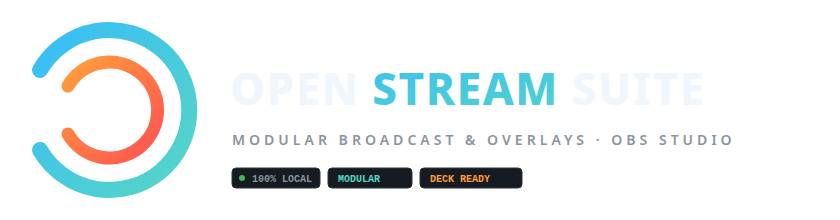

# 🎨 IMAGENCORP — Visual Identity & Brand Assets
### Open Stream Suite · Brand Manual & Graphical Resources

<p align="center">
  <a href="README.md">Español</a> | <b>English</b>
</p>

This directory contains all official graphic assets, minimalist vector logos, GitHub headers, and screenshots for **Open Stream Suite**.

---

## 💎 1. Identity Philosophy & Logo

The **Open Stream Suite** logo is designed following contemporary software design principles (geometric, minimalist, timeless, without AI-generated artifacts):

- **Geometric Mark**:
  - **Outer Cyan Arc (`#57D6C4` / `#38BDF8`)**: Represents broadcast waves, signal openness, open-source transparency, and real-time connectivity with the streaming community.
  - **Inner Coral Arc (`#FF9E3B` / `#FF5252`)**: Represents live dynamic energy, alert triggers, and interactive vibrancy.
  - **Pure White Central Core**: A directional transmission prism (*play/trigger*), focusing attention on the streamer's content.
- **Typography**: Clean monospace and geometric sans-serif with high readability on high-DPI displays.

---

## 🎨 2. Official Color Palette

| Color | Hex | Role in Visual Identity |
| :--- | :--- | :--- |
| **Obsidian Dark** | `#0B0E14` | Primary background, night broadcast canvas |
| **Surface Dark** | `#161B22` | Cards, elevated containers, and docks |
| **Border Dim** | `#30363D` | Subtle divider lines and technical frames |
| **Cyber Cyan** | `#57D6C4` | Primary accent, WebSocket status, active states |
| **Electric Sky** | `#38BDF8` | Gradient start of the broadcast beam |
| **Coral Sunset** | `#FF783F` | Secondary accent, alerts, interaction, deck controls |
| **Crimson Coral** | `#FF5252` | Warm gradient terminal |
| **White Glow** | `#F0F6FC` | High-contrast foreground typography |
| **Muted Grey** | `#8B949E` | Technical metadata, subtitles, and badges |

---

## 📁 3. Inventory of Logos & Vector Files

All SVG files are mathematically clean vectors that scale to any resolution without pixelation.

### A. Headers & Banners
* **[banner_github_header.svg](./banner_github_header.svg)** (1280 × 400 px): Main banner for the GitHub `README.md` header with obsidian background and official badges.
* **[banner_github_header.png](./banner_github_header.png)**: High-resolution raster rendering for social previews and GitHub Releases.

### B. Horizontal Logos
* **[logos/logo_horizontal.svg](./logos/logo_horizontal.svg)** (840 × 220 px): Mark + Typography "OPEN STREAM SUITE" + subtitle "MODULAR BROADCAST & OVERLAYS" + badges.
* **[logos/logo_horizontal.png](./logos/logo_horizontal.png)**: Transparent PNG version for websites and documentation headers.

### C. Square Symbols & Icons
* **[logos/logo_symbol.svg](./logos/logo_symbol.svg)** (512 × 512 px): Curved squircle icon for desktop applications (.desktop, .exe, .app) and GitHub/Discord profile avatars.
* **[logos/logo_symbol.png](./logos/logo_symbol.png)**: 512×512 px PNG render.
* **[logos/logo_transparent.svg](./logos/logo_transparent.svg)**: Mark without background container, perfect for overlays or watermarks.

### D. Favicons
* **[logos/favicon.svg](./logos/favicon.svg)**: Native vector favicon for modern web browsers.
* **[logos/favicon-64.png](./logos/favicon-64.png)**: 64×64 px PNG favicon.
* **[logos/favicon-32.png](./logos/favicon-32.png)**: 32×32 px PNG favicon.

---

## 📸 4. Live System Screenshots

Real high-resolution screenshots (1920 × 1080 px) of the software in action:

| Screenshot | File | Content |
| :--- | :--- | :--- |
| **Control Dashboard** | [screenshots/panel_dashboard.png](./screenshots/panel_dashboard.png) | Web control panel with live status, connected OBS clients, triggers, and console. |
| **Theme Studio** | [screenshots/panel_themes.png](./screenshots/panel_themes.png) | Neon palette picker (Cyberpunk, Maker, Synthwave, Lofi, Blueprint) and reset tool. |
| **Scene Catalog** | [screenshots/catalog_scenes.png](./screenshots/catalog_scenes.png) | Interactive showcase of all OBS Studio overlays and modular templates. |
| **Gameplay Overlay** | [screenshots/overlay_game.png](./screenshots/overlay_game.png) | Live gaming broadcast overlay with camera frame and event ticker. |
| **Multicam Overlay** | [screenshots/overlay_multicam.png](./screenshots/overlay_multicam.png) | Technical scene with secondary camera and broadcast telemetry. |

---

## 💡 5. Markdown Embedding Examples

### Adding Header Banner:
```markdown
<p align="center">
  
</p>
```

### Adding Horizontal Logo:
```markdown
<p align="center">
  
</p>
```
